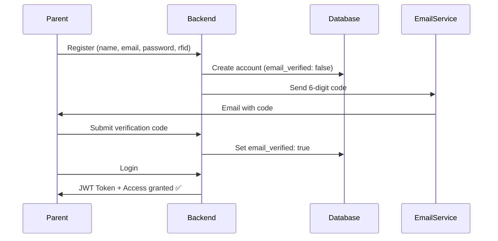

# 📧 Email Verification for Parent Accounts

> **Status**: ✅ Fully Implemented & Ready for Testing

## What's This?

When parents create an account on the Benedicto College Parent Portal, they now receive a **6-digit verification code** via email. They must enter this code to activate their account before they can login.

**Why?** To ensure parents register with valid email addresses and prevent fake accounts.

---

## ⚡ Quick Start

### Step 1: Run Migration
```bash
npm run migrate:emailverification
```

### Step 2: Configure Email
Add to `.env`:
```env
ENABLE_EMAIL=true
SMTP_HOST=smtp.gmail.com
SMTP_PORT=587
SMTP_USER=your-email@gmail.com
SMTP_PASS=your_gmail_app_password
SMTP_FROM=Benedicto College <your-email@gmail.com>
```

### Step 3: Test
Open `email-verification-tester.html` in your browser!

**That's it!** 🎉

---

## 📖 Documentation

| Document | For Who | What's Inside |
|----------|---------|---------------|
| 📄 **QUICK_START_EMAIL_VERIFICATION.md** | Everyone | 5-minute setup guide |
| 📋 **EMAIL_VERIFICATION_SUMMARY.md** | Technical | Complete overview |
| 🔧 **EMAIL_VERIFICATION_GUIDE.md** | Backend | Full API docs |
| 💻 **FRONTEND_EMAIL_VERIFICATION.md** | Frontend | React/Next.js code |
| ⚙️ **SETUP_EMAIL_VERIFICATION.md** | DevOps | Deployment guide |

**Recommendation**: Start with `QUICK_START_EMAIL_VERIFICATION.md`

---

## 🎯 User Experience

### For Parents:

1. **Register**: Fill out registration form with name, email, password, RFID tag
2. **Check Email**: Receive email with 6-digit code (e.g., `123456`)
3. **Verify**: Enter code on verification page
4. **Login**: Access the parent portal!

### If Code Expires:
- Click "Resend Code"
- New email sent with new code
- Code expires in 15 minutes

---

## 🔌 New API Endpoints

### ✅ Added

```
POST /api/parents/verify-email
POST /api/parents/resend-verification
```

### 🔄 Modified

```
POST /api/parents/register  - Now sends verification email
POST /api/parents/login     - Now requires verified email
```

---

## 📊 How It Works



---

## 🧪 Testing

### Manual Testing with HTML Tool
1. Open `email-verification-tester.html`
2. Register test account
3. Check email for code
4. Verify with code
5. Login successfully

### API Testing with cURL
```bash
# Register
curl -X POST http://localhost:3001/api/parents/register \
  -H "Content-Type: application/json" \
  -d '{"name":"Test","email":"test@gmail.com","password":"pass123","rfid_tag_uid":"ABC123"}'

# Verify (use code from email)
curl -X POST http://localhost:3001/api/parents/verify-email \
  -H "Content-Type: application/json" \
  -d '{"email":"test@gmail.com","code":"123456"}'

# Login
curl -X POST http://localhost:3001/api/parents/login \
  -H "Content-Type: application/json" \
  -d '{"email":"test@gmail.com","password":"pass123"}'
```

---

## 🛡️ Security Features

✅ Time-limited codes (15 minutes)  
✅ One-time use (cleared after verification)  
✅ Login protection (blocks unverified accounts)  
✅ Secure storage (database, not URLs)  
✅ Email format validation  

---

## 🔧 Technical Details

### Database Changes
Added 3 columns to `parents` table:
- `email_verified` (BOOLEAN)
- `verification_code` (VARCHAR)
- `verification_code_expires` (DATETIME)

### Files Created
- `src/services/emailVerificationService.ts`
- `src/scripts/addEmailVerification.ts`
- `email-verification-tester.html`
- Documentation files

### Files Modified
- `src/models/Parent.ts`
- `src/controllers/parentController.ts`
- `src/routes/parents.ts`
- `package.json`

---

## ⚠️ Important Notes

### Existing Parent Accounts
If you have existing parents in the database, either:

**Option A**: Auto-verify them (recommended)
```sql
UPDATE parents SET email_verified = true;
```

**Option B**: Require verification on next login

### Email Configuration
- **Development**: Gmail SMTP works fine (500 emails/day limit)
- **Production**: Use SendGrid (SMTP blocked on Railway)

### Gmail App Password Required
Regular Gmail password won't work - you need an App Password:
1. Visit https://myaccount.google.com/apppasswords
2. Generate new password
3. Add to `.env` as `SMTP_PASS`

---

## 🚀 Production Deployment

Before deploying to production:

1. ✅ Switch to SendGrid (`SENDGRID_API_KEY` in `.env`)
2. ✅ Run migration on production database
3. ✅ Test email delivery (check spam!)
4. ✅ Update frontend with verification UI
5. ✅ Handle existing parent accounts
6. ✅ Monitor email delivery rates

---

## 💻 Frontend Integration

The frontend needs to implement:

1. **Verification Page** (`/verify-email`)
   - 6-digit code input
   - "Resend Code" button
   - Success/error messages

2. **Updated Registration Flow**
   - Redirect to verification after success

3. **Updated Login Flow**
   - Handle "email not verified" error
   - Redirect to verification page

**Complete code examples**: See `FRONTEND_EMAIL_VERIFICATION.md`

---

## 🆘 Troubleshooting

### Emails not sending?
- Check `ENABLE_EMAIL=true` in `.env`
- Verify SMTP credentials
- For Gmail: Use App Password
- Check server logs for errors

### Can't login?
- Did you verify your email?
- Check for "EMAIL_NOT_VERIFIED" error
- Use resend endpoint if code expired

### Migration failed?
- Is MySQL running?
- Check DB credentials in `.env`
- Run `npm run migrate:emailverification` again

---

## 📞 Get Help

| Issue | Solution |
|-------|----------|
| Setup questions | Read `QUICK_START_EMAIL_VERIFICATION.md` |
| API questions | Read `EMAIL_VERIFICATION_GUIDE.md` |
| Frontend questions | Read `FRONTEND_EMAIL_VERIFICATION.md` |
| Deployment questions | Read `SETUP_EMAIL_VERIFICATION.md` |
| Testing | Use `email-verification-tester.html` |

---

## ✨ Features

🎯 **User-Friendly**: Simple 6-digit codes  
⚡ **Fast**: 15-minute expiration  
🔒 **Secure**: Time-limited, one-time use  
📧 **Professional**: Branded email templates  
🔄 **Flexible**: Gmail (dev) + SendGrid (prod)  
🛠️ **Testable**: Interactive HTML tool  
📚 **Documented**: Complete guides  

---

## 📊 Status

| Component | Status |
|-----------|--------|
| Backend API | ✅ Complete |
| Database Migration | ✅ Complete |
| Email Service | ✅ Complete |
| Documentation | ✅ Complete |
| Testing Tool | ✅ Complete |
| Frontend UI | 🔄 Pending |

---

## 🎉 Next Steps

1. ✅ Backend implementation (you're reading this!)
2. 🔄 Test with `email-verification-tester.html`
3. 🔄 Implement frontend verification page
4. 🔄 End-to-end testing
5. 🔄 Production deployment

---

## 📝 Version History

**v1.0.0** (November 6, 2026)
- Initial implementation
- Full email verification flow
- Testing tools
- Complete documentation

---

**Questions?** Check the guides or open `email-verification-tester.html` to test!

**Ready to deploy?** See `SETUP_EMAIL_VERIFICATION.md` for production checklist.
